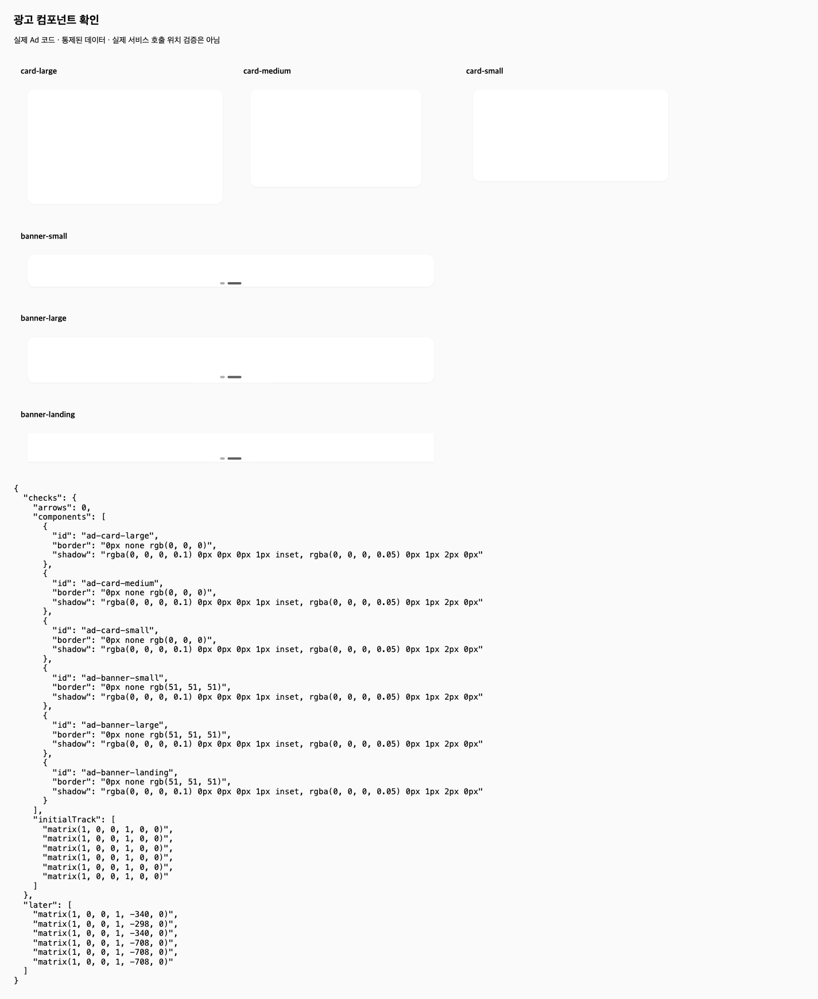

# 광고 사례 동일 조건 경쟁 도구 재실행 — 2026-10-16

이번 한 사례는 OMC가 요구를 충족했고, oh-my-claudecode는 불투명 이미지에 테두리가 가려져 요구를 충족하지 못했다. 두 도구 모두 실제 브라우저 검증을 수행했다. 검증 수행과 요구 충족을 구분해 판정했다.

## 동일 조건과 실제 활성화

직전 OMC 실행(9255a00)의 초기 Ad14파일·Home 검수 입력과 디자인을 같은 fixture commit 3655c8cc에서 구성했다. 공통 요청 및 tests/lint/browser-controlled/browser-home 네 검증 파일의 바이트 해시가 일치한다. Sonnet4.6 Bedrock/high, 제한1200초, 별도 1440×1000 Chromium, 같은 검수 계정, 광고 이미지2개·카드 자동전환·같은 제외 규칙을 시작 전에 확인했다. builder/browser helper도 동일하며 runtime의 포트·arm만 다르다.

Claude init에 oh-my-claudecode 5.6.2 플러그인이 로드됐고, Skill 도구로 oh-my-claudecode:execute가 실제 호출됐다. 이전 비교와 같은 frozen 플러그인을 사용했다. OMC 전용 complete-task·기계 envelope는 경쟁 도구에 설치하거나 점수 조건으로 강요하지 않았다. 공통 요청 원문은 같고, 도구별 adapter는 서로 다르다.

준비 중 대화가 중단되며 서버와 제어 연결이 종료됐다. 준비 검사는 connection refused를 모델 호출0회로 차단했다. 새 서버에서 로그인된 홈과 카드 준비를 다시 확인한 새 report로 시작했다. 이전 blocked report는 보존했으며 실제 모델 실행은1회다. 이 준비 시간은 모델 실행 시간에서 제외한다.

## 독립 결과

| 확인 대상 | OMC | oh-my-claudecode |
| --- | --- | --- |
| 모델 실행 시간 | 486.24초(8분6초) | 611.43초(10분11초) |
| 실행 중 사람 교정 | 0회 | 0회 |
| 이미지 위 테두리 | 통제6종 가장자리RGB229, 내부255 | 통제6종 가장자리·내부 모두255: 선 가림 |
| 구현 방식 | 실제1px border + 바깥 그림자 | 1px inset shadow + 바깥 그림자 |
| 카드 화살표 제거·전환 | 확인 | 확인 |
| 실제 홈 | 이미지2개·카드 전환·현재 선 표시 확인 | 이미지2개·카드 전환 확인; 선은 이미지에 가림 |
| 브라우저 직접 검증 | 통제화면·실제홈·PNG Read | 통제화면·실제홈·PNG Read |
| 작업 범위 | 통과 | 통과, 범위 밖 변경0 |
| 독립 테스트 | 49통과·기존4실패 | 41통과·기존4실패 |
| 변경 파일 린트 | exit0 | exit0 |
| 필수 화면 요구 | 충족 | 테두리 가시성 미달 |

테스트 수 자체를 도구 품질 점수로 사용하지 않았다. 경쟁 도구의 기존4실패는 baseline과 이름 및 stack 경로/라인을 제외한 진단이 같고 신규 실패는 없다. 신규 테스트9개를 추가한 OMC와 단순 통과 수를 바로 점수화하지 않는다.

## 무엇이 달랐나

경쟁 도구는 CSS computed box-shadow에 inset 선 값이 있다는 것을 확인한 뒤 완료로 보고했다. 그러나 흰색 불투명 자식 이미지가 그 선을 덮는다. 독립 스크린샷의 곧은 가장자리와 내부를 같은 좌표 방식으로 샘플링하면 둘 다 RGB255다. OMC의 같은 통제 이미지에서는 가장자리229/내부255로 선이 분리된다. 실제 홈에서도 경쟁 도구의 카드 가장자리와 내부 픽셀이 같고 border가0이다. 외부 그림자 자체와 카드 전환은 유지됐다.

따라서 경쟁 도구가 검증을 생략했다고 결론 내리지 않는다. 이번 차이는 화면을 확인하고도 요구 미충족을 성공으로 판단한 것이다. OMC 전용 보고 형식이 없다는 이유로 감점하지 않았다. 이번 OMC 결과에는 같은 테두리 문제가 없지만, 이 가시성 검사를 공통 자동 판정으로 고정하는 것이 남은 개선 후보다.

## 해석 경계와 보존

동일한 공통 입력·모델을 사용한 순차 단일 사례이며 블라인드·반복 실험이 아니다. 실행 시간 차이를 OMC만의 생산성 개선 효과나 일반 우위로 확장하지 않는다. 클릭 추적·오늘 하루 숨김의 실제 외부 전송은 양쪽 모두 미실행이고, 기존 추적4실패도 미해결이다. 원본 storefront·기존 OMC 실행·스테이징12개 및 로드맵·대시보드 기존 변경을 보존했다. 이번 결과는 새 미커밋 기록이며 추가 커밋·서비스 반영·릴리스는 수행하지 않았다.

[실행 요약](comparison-dashboard/evidence/ad-competitor-parity-20261016/summary.json) · [경쟁 도구 최종 원문](comparison-dashboard/evidence/ad-competitor-parity-20261016/final.txt) · [플러그인·스킬 증거](comparison-dashboard/evidence/ad-competitor-parity-20261016/workflow-trace.json) · [픽셀 대조](comparison-dashboard/evidence/ad-competitor-parity-20261016/border-pixels.json) · [범위 판정](comparison-dashboard/evidence/ad-competitor-parity-20261016/scope-assessment.json) · [원문 해시](comparison-dashboard/evidence/ad-competitor-parity-20261016/provenance.json)

### OMC 통제 화면

### 경쟁 도구 통제 화면

