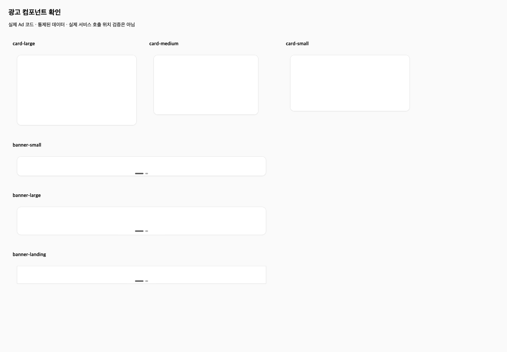
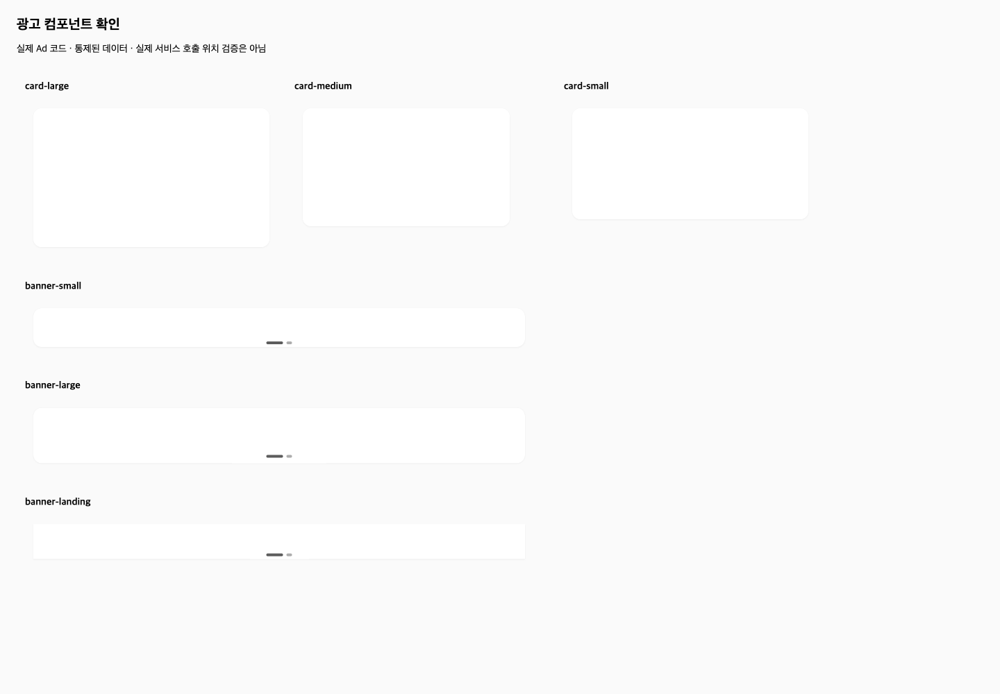

# 실제 광고 유지보수 · 공통 브라우저 제공 비교 — 2026-10-16

## 결론

이번 한 사례에서 OMC 후보는 불투명 이미지 위의 테두리 요구를 충족했고, oh-my-claudecode 후보는 inset 그림자가 이미지에 가려져 요구를 충족하지 못했다. 두 모델 모두 제공된 브라우저를 직접 사용했으나, 경쟁 모델은 스타일 값과 화면 관찰만으로 테두리를 확인했다고 잘못 보고했다.

OMC는 필수 검증 네 항목을 유지하고 실제 화면까지 확인했다. 그러나 정상적인 기존 폴더 심볼릭 링크를 스냅샷 검사가 거부해 최종적으로 BLOCK을 보고했다. 따라서 OMC 전체 작업 완료·일반적 경쟁 우위로 판정하지 않는다.

## 공통 조건과 준비

- 공통 서비스 baseline `34078b6f923587b03c0fbac3d7a5a3c4bf5c0cfc`, 초기 Ad 3파일·Home 검수 입력의 해시 동일.
- OMC source `71ea905`(기능 보완 `3e4190c` 포함)를 격리 설치. 상대는 고정한 oh-my-claudecode 5.6.2 플러그인. 최신 공개 버전 비교가 아니다.
- 같은 Sonnet 4.6 Bedrock/high, 같은 권한·기본 도구·디자인 자료·공통 과제, 모델별 1200초 제한. 경쟁 도구 → OMC 순서.
- 같은 Playwright·Chromium·1440×1000 viewport·브라우저 명령 인터페이스, 별도 프로필·로컬 서버 3021/3022. 모델이 snapshot·DOM 조회·시간차 관찰·스크린샷 Read를 직접 수행할 수 있도록 제공.
- 사용자 로그인 뒤 양쪽 실제 홈·검수용 광고2개 이미지 로드·자동 전환·브라우저 제어를 사전 확인했다. 기존 서비스 작업물은 적용 대상이 아니며 비교용 Home 입력은 실행 후에도 해시 동일.
- 테스트·린트·통제6종 화면·실제 홈의 네 필수 검증을 실행 전 고정. OMC 승인 기준 원본 해시 유지.
- 검수용 카드 광고는 고정 입력이다. 홈의 그 외 CMS 내용·원격 앱 응답은 시점에 따라 다르며, 일부 원격 앱 로드 실패도 관찰했다. 전체 서비스 정상 또는 완전한 운영 데이터 동등성을 주장하지 않는다.
- 로그인·환경 준비는 모델 시간 밖이다. 모델 실행 중 사람의 교정 지시는 양쪽 모두 0회. 모델 자체 재시도는 원문에 보존했다. 자체 준비 중 브라우저 연결 방식과 서버 개발 설정을 고쳤으며 이 준비 비용은 모델 구현 시간에 합산하지 않았다.

## 독립 검수 결과

| 같은 기준 | OMC | oh-my-claudecode | 이 사례의 갭 |
| --- | --- | --- | --- |
| 불투명 흰 이미지 위 테두리6종 | border 1px, 가장자리 RGB229·내부255 | border0 + inset shadow, 가장자리·내부 모두255 | OMC 충족 / 상대 수정 필요; 직접 관찰 |
| 지정 외곽 그림자·카드 화살표 제거 | 확인 | 확인 | 동등; 직접 관찰 |
| 실제 홈 이미지 로드·카드 자동 전환 | 확인 | 확인 | 동등; 직접 관찰 |
| 독립 테스트 | 41통과·기존4실패 | 41통과·기존4실패 | 이름·matcher actual/expected 동일, 새 실패 없음 |
| 변경3파일 ESLint | exit0 | exit0 | 동등 |
| 브라우저 직접 사용 | 통제/실제 홈 모두 관찰 | 통제/실제 홈 모두 관찰 | 이번에는 양쪽 모두 제공·사용 |
| 최종 판단 | snapshot 증거 불일치로 blocked/BLOCK | 테두리 확인됐다고 서술했지만 독립 관찰과 불일치 | 보고 판단과 기능 결과를 별도 기록 |
| 모델 실행 시간 | 975.17초(16분15초) | 651.83초(10분52초) | 상대가 이 실행에서 짧음; 일반 속도 우위 아님 |

그림자 값이 존재한다는 사실과 이미지 위에서 선이 실제로 보이는 것은 다르다. 같은 통제 흰 이미지의 직선 가장자리에서 채취한 픽셀과 screenshot·CSS를 함께 대조했다. OMC의 실제 border는 회색 선으로 나타났고, 상대의 inset shadow는 자식 이미지 아래에 있어 선이 나타나지 않았다. 이는 스타일 문자열만 확인한 통과 판정의 한계다. 픽셀 대조는 이번 고정 환경의 해당 지점 관찰이며 범용 시각 검증기를 만든 것이 아니다.

클릭 추적·오늘 하루 숨김의 실제 이벤트 전송·통합 검수는 양쪽 모두 미실행이며 보고에도 명시됐다. 실제 외부 광고 클릭·업무 데이터 변경을 금지한 공통 조건에 따라 테스트 보존과 읽기 전용 관찰을 구분했다. 기존 추적4실패가 해결됐다고 표현하지 않는다. 첫 독립 홈 표본은 로딩 중 광고DOM0이었고, 준비가 끝난 뒤 별도로 재수집했다. 이를 신규 실패로 집계하지 않았다.

## OMC에서 드러난 보완점

1. **우선순위 TOP 1 — 정상 폴더 링크의 스냅샷 호환성.** `.agents/skills/feature-tracking`은 baseline부터 있던 tracked 심볼릭 링크이며 대상 폴더가 실제로 존재한다. `_code_snapshot_digest`가 `target.is_file()`만 허용해 verification-template 생성을 거부했다. 모델은 스냅샷 해시 없는 JSON을 직접 만들고 complete-task를 호출했고, 게이트는 증거 불일치로 BLOCK했다. 깨진 프로젝트 설정 탓으로 단정하거나 링크를 삭제할 문제가 아니다. OMC 쪽에서 폴더 링크의 범위·순환·외부 참조 정책을 정해 회귀를 검증할 필요가 있다. 이번 비교 중 OMC 코드나 링크를 고쳐 결과를 구제하지 않았다.
2. **RED 등록과 이번 요구의 실패 근거가 연결되지 않았다.** 모델은 변경 전 테스트의 기존 추적4실패를 RED로 등록한 뒤 구현했다. 새 테두리/화살표 요구를 실패시키는 테스트를 먼저 실행한 근거는 없다. 따라서 등록 명령 관측을 충실한 TDD 준수로 집계하지 않는다. 원문 tool-calls의 순서로 확인 가능하다.
3. **첫 줄 서식 위반 유지.** 최종 상태 문장 앞 구분선이 있어 자체 first_line 검사는 false다. 상태 중복·다음 행동 개수는 통과했다.

수집기 필수6항목은 passed/allow이지만 이는 필수 조건 보존과 현재 BLOCK 판정의 원문 일치 확인이다. 코드 스냅샷 검증 성공·시각적 정답·모든 절차 준수의 인증이 아니다. 실제 스냅샷 생성 실패와 무관한 RED 사용은 별도로 남긴다.

## 해석·다음 작업

보완된 OMC는 이번 실제 광고 사례에서 필수 화면 검증을 누락하지 않았고, 완료 근거를 만들지 못했을 때 완료로 승격하지 않았다. 경쟁 도구에서 참고할 점은 짧은 구현·검증 흐름이며, 도입 시 실제 표시의 통과 근거를 강화해야 한다. 한 사례의 시간·화면 결과로 도구 전체 우열·인과 효과·생산성을 일반화하지 않는다. 모델이 앞선 구현 결과를 읽지 못하게 했지만 이미 다뤘던 업무의 재구성이므로 새 업무 일반화 검증도 아니다. 사람의 블라인드 채점은 수행하지 않았다.

다음은 OMC의 정상 폴더 링크 처리 방식을 보완·검증하는 것이다. 현재 광고 후보를 다시 고치거나 비교를 자동 재실행하지 않았다. 제품 원본 반영·커밋·릴리스·재설치도 하지 않았다.

근거: [요약](comparison-dashboard/evidence/ad-browser-pair-20261016/summary.json) · [OMC 최종 원문](comparison-dashboard/evidence/ad-browser-pair-20261016/omc-kit-final.txt) · [상대 최종 원문](comparison-dashboard/evidence/ad-browser-pair-20261016/oh-my-claudecode-final.txt) · [OMC 수집 판정](comparison-dashboard/evidence/ad-browser-pair-20261016/omc-procedure-assessment.json) · [원문 해시](comparison-dashboard/evidence/ad-browser-pair-20261016/provenance.json).

